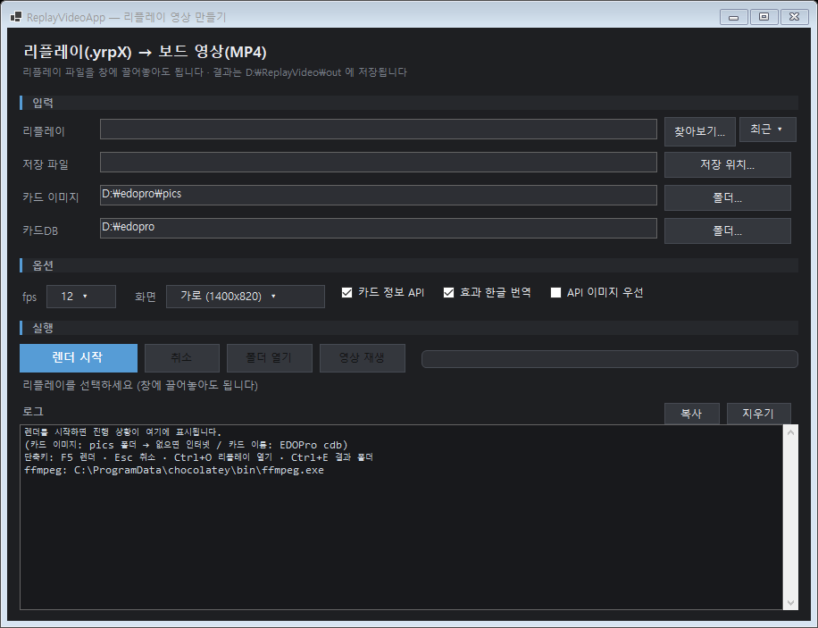
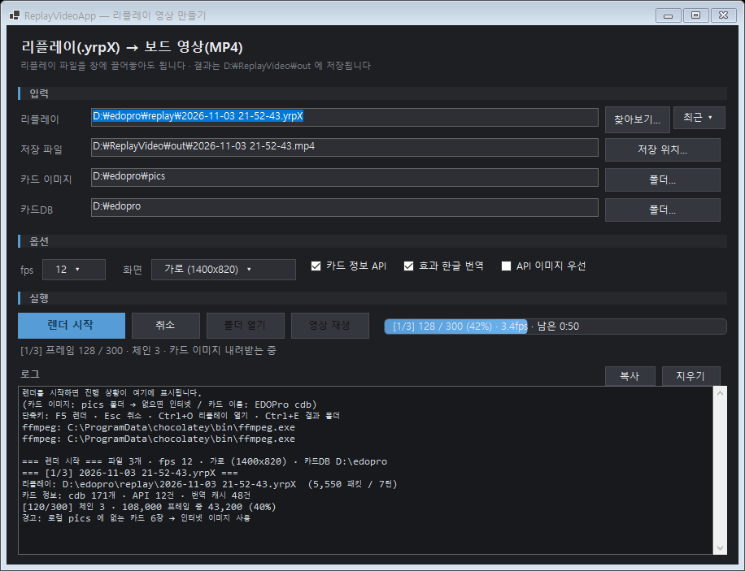
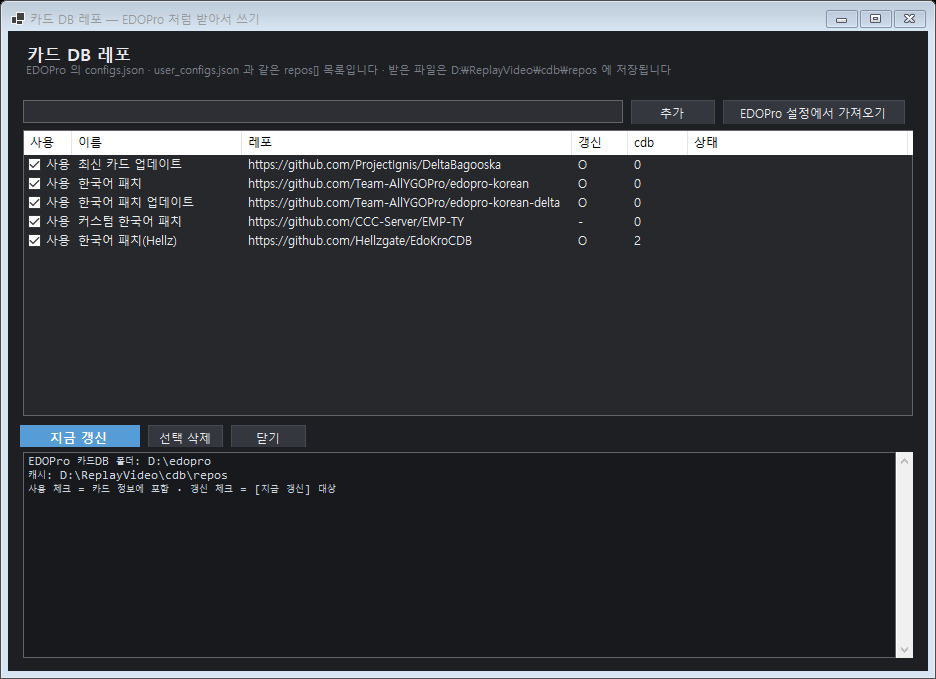

# ReplayVideoApp

**EDOPro 리플레이(`.yrpX`) → 보드 영상(MP4)** 을 클릭 몇 번으로 만드는 윈도우 앱.



> 게임 엔진(ygopro-core) 없이 리플레이의 `MSG_*` 스트림만으로 보드를 재구성합니다.
> 렌더 엔진은 CLI 프로젝트 [ReplayVideo](../ReplayVideo) 를 그대로 참조합니다(동작 동일).

## 기능

| 구분 | 내용 |
|---|---|
| 입력 | 리플레이 끌어놓기 · **여러 개 선택하면 순서대로 일괄 변환** · **최근 파일**(10개) |
| 출력 | 저장 경로 자동(`D:\ReplayVideo\out`) · **이전에 쓴 폴더 기억** |
| 옵션 | fps(8/12/15/24) · 가로(1400×820)/세로(1080×1920) · 카드 정보 API · 효과 한글 번역 · API 이미지 우선 |
| 카드 DB | **EDOPro 폴더 자동 탐색**(`D:\edopro` → `C:\ProjectIgnis` → `C:\EDOPro`) · **레포에서 받기**(EDOPro `configs.json`·`user_configs.json` 의 `repos[]` 그대로) |
| 카드 이미지 | 로컬 `pics` 없으면 **YGOPRODeck 에서 자동 다운로드** |
| 진행 | `%` · 프레임/전체 · **속도(fps)** · **남은 시간** · 일괄이면 `[2/5]` |
| 완료 | 결과 크기/시간 표시 · **[폴더 열기]** · **[영상 재생]** |
| 기타 | 로그 복사/지우기 · 설정 자동 저장 · 다크 테마 · DPI 대응 |

단축키: `F5` 렌더 · `Esc` 취소 · `Ctrl+O` 열기 · `Ctrl+E` 결과 폴더 · `Ctrl+L` 로그 지우기



## 실행

`ReplayVideoApp.exe` 단일 파일(자체 포함, .NET 설치 불필요) 하나로 동작합니다.

1. 리플레이(`.yrpX`) 선택 — **여러 개 선택하면 첫 파일부터 순서대로** 변환
2. 필요하면 옵션 조정 (기본값 권장)
3. **[렌더 시작]** → 진행률/남은 시간 → 완료 시 **[영상 재생]**

결과 기본 경로: `D:\ReplayVideo\out\<리플레이 이름>.mp4`
(캐시·프레임도 `D:\ReplayVideo\{cache,frames}` — C: 용량을 쓰지 않습니다)

### 준비물

| 항목 | 설명 |
|---|---|
| **ffmpeg** | MP4 인코딩에 필요. 없으면 **PNG 프레임만** 만들어집니다(앱이 시작할 때 알려줍니다) |
| 인터넷(선택) | 카드 이미지/이름을 YGOPRODeck 에서 보완. EDOPro `pics`+cdb 가 있으면 없어도 됩니다 |

## 카드 DB 레포 (EDOPro 방식)

EDOPro 를 설치하지 않은 PC 에서도 **카드 이름·효과 텍스트**를 쓰도록, EDOPro 와 같은 레포 모델을 지원합니다.

- `카드DB` 행의 **[레포…]** → 목록 창
  - **[EDOPro 설정에서 가져오기]** — `config/configs.json` + `config/user_configs.json` 의 `repos[]`(url·repo_name·repo_path·should_read·should_update)를 그대로 읽음
  - 레포 주소 직접 추가 · 사용/갱신 체크 · **[지금 갱신]**
- 받은 위치: `D:\ReplayVideo\cdb\repos\<owner>_<repo>` (`C:` 를 쓰지 않음)
  - **git 이 있으면** `clone --depth 1` / `fetch + reset` (MinGit·Git for Windows 자동 인식)
  - **없으면** `codeload.github.com` zip 으로 받아 풀기(git 설치 불필요)
- 카드 정보 로딩 순서: **한국어 cdb 먼저** → 나머지 (먼저 연 파일이 이름을 이깁니다)
- 카드 이미지(`pics`)는 이 기능에 포함되지 않습니다(용량이 커서 별도).



## CLI (검증·자동화용)

```
ReplayVideoApp.exe --render <replay.yrpX> <out.mp4> [--fps N] [--portrait] [--pics DIR] [--cdb EDOPro폴더] [--no-api] [--img-api]
ReplayVideoApp.exe --uicheck                 창 없이 UI 구성 검사
ReplayVideoApp.exe --screenshot <png> [--busy] [--log]   화면 PNG 저장(레이아웃 확인)
```

## 빌드

```powershell
dotnet build -c Release
dotnet publish -c Release -r win-x64 --self-contained true -p:PublishSingleFile=true `
  -p:IncludeNativeLibrariesForSelfExtract=true -o dist\ReplayVideoApp
```

> **빌드 준비 — 형제 폴더 2개가 필요합니다**
> 이 저장소는 `..\ReplayVideo\ReplayVideo.csproj` 를 **프로젝트 참조**하고,
> `ReplayVideo` 는 다시 `..\_shared\ReplaySim.cs` 를 링크 컴파일합니다.
> 셋을 같은 상위 폴더에 나란히 두세요: `ReplayVideoApp` · `ReplayVideo` · `_shared`
> (배포 백업 ZIP 에는 필요한 `_shared` 파일이 포함되어 있습니다.)

## 한계

- 리플레이에는 **선택/응답이 기록되지 않습니다** → 화면 캡션으로만 표시됩니다.
- 원본 게임의 이펙트·연출은 재현하지 않습니다(2D 보드 애니메이션).
- 영상 길이는 실제 듀얼 시간이 아니라 **이벤트 수 × 프레임 수 / fps** 로 정해집니다.
